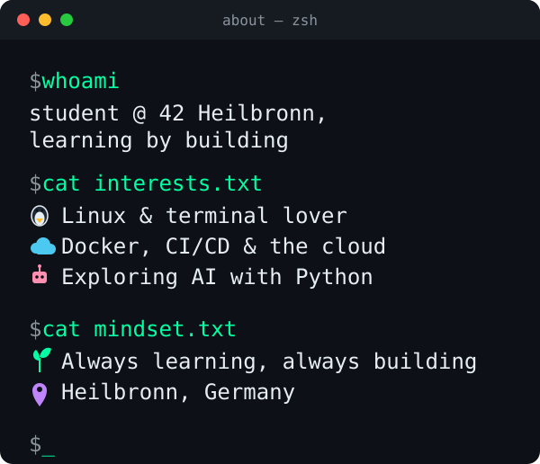

<div align="center">


<br/>

<a href="https://github.com/DenverCoder1/readme-typing-svg"></a>

<br/>


</div>

---


## 👩‍💻 About me

 <p align="center">
  
</p>

<!-- Text version of the terminal image above. If the image gets stale, delete the <p> image block and keep this text. -->
<!--
```bash
$ whoami
student @ 42 Heilbronn,
learning by building

$ cat interests.txt
🐧 Linux & terminal lover
☁️ Docker, CI/CD & the cloud
🤖 Exploring AI with Python

$ cat mindset.txt
🌱 Always learning, always building
📍 Heilbronn, Germany
```
-->
---

## 🛠 Tech stack

**🐳 DevOps**

    

**🤖 AI & backend / databases**

    

**🐍 Languages**

    

**🎨 Frontend**

   

---

## 🚀 Featured projects

| Project | What it is | Language |
|---|---|---|
| [GoalCoach](https://github.com/jiyan-0525/GoalCoach) | Adaptive AI coach for learning Chinese | Python |
| [42core_webserv](https://github.com/jiyan-0525/42core_webserv) | 42 project: HTTP web server | C++ |
| [42Core_minishell](https://github.com/jiyan-0525/42Core_minishell) | 42 project: Unix shell | C |
| [42core_Inceptions_bonus_DigitalOcean](https://github.com/jiyan-0525/42core_Inceptions_bonus_DigitalOcean) | 42 project: Inception, bonus DigitalOcean deployment | YAML · Bash |

---

## 📊 GitHub stats

<div align="center">


<br/><br/>


</div>

---

## 📫 Get in touch

<div align="center">

<a href="https://jiyan-0525.github.io"></a>
<a href="https://github.com/jiyan-0525"></a>
<a href="https://www.linkedin.com/in/jiyan-wang-7a69b229a"></a>
<a href="mailto:jiyanw825@gmail.com"></a>

</div>
